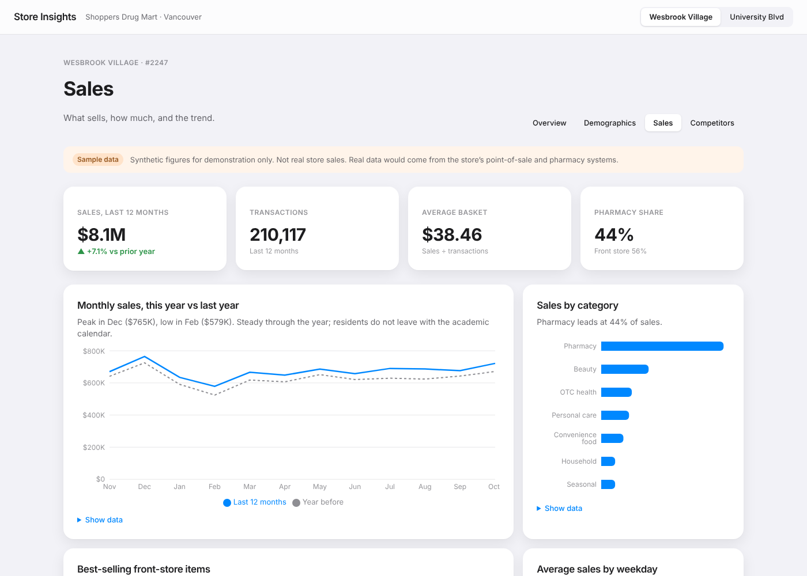
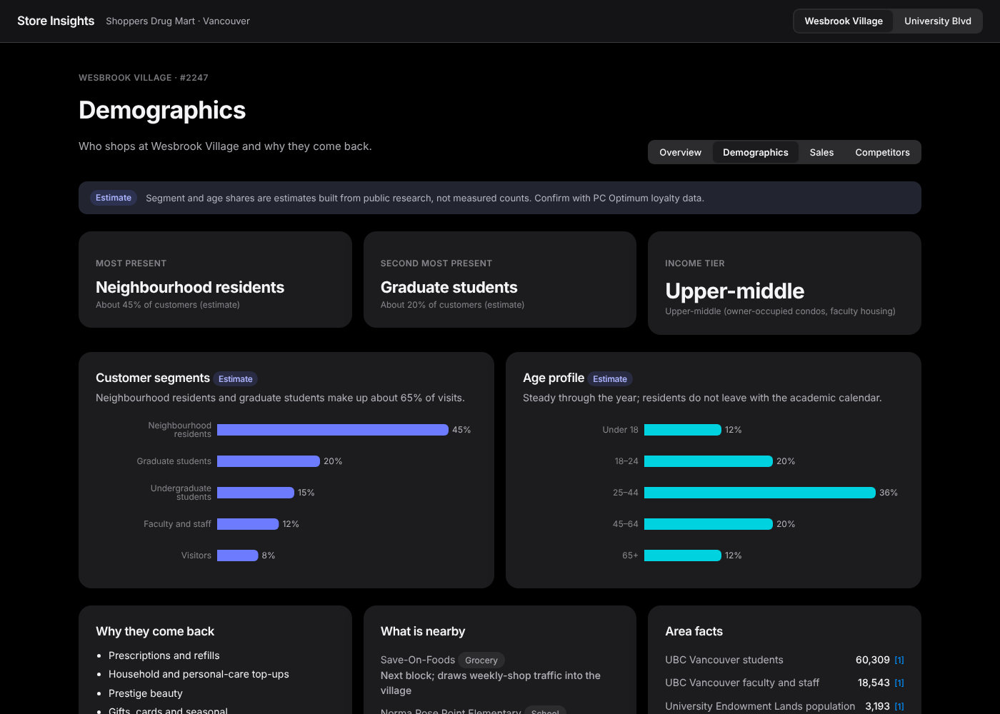

# Store Insights

A store analytics dashboard for retail head office. Open one page, pick a store on the map, and see what kind of store it is, who shops there, what sells, who competes nearby, and who runs it.

Version 1 covers two Shoppers Drug Mart stores at the University of British Columbia, Vancouver:

- **#2247 Wesbrook Village**, 5968 Webber Lane
- **#2273 University of BC**, 5940 University Blvd

**Live demo:** https://codingwithathul.github.io/Retail-dashboard-analytics/



## What it shows

| View | Answers |
|---|---|
| **Overview** | Map of the stores. Store summary, format, hours, Key Differentiators, Store Leadership, pharmacy services. |
| **Demographics** | Who shops here (segments, age profile), why they come back, what is nearby, area facts with sources. |
| **Sales** | Last-12-month sales and growth, transactions, average basket, monthly trend vs last year, category mix, best-selling items, busiest weekdays. |
| **Competitors** | Nearby competitors with distance, who sells what, and a Compete / Differentiate / Avoid call for each category. |

Example insight: the Wesbrook store sits one block from a Save-On-Foods, so the Competitors tab recommends **avoiding fresh grocery** there and putting the space into beauty and health services instead.



## Data policy

- **Store facts** (address, hours, services) come from public store pages. **Area facts** come from UBC and census sources. Each is marked *Verified* and linked to its source.
- **Customer segment shares** are *Estimates* built from public research.
- **Sales figures are synthetic sample data**, built by the [data pipeline](pipeline/README.md) from a fixed seed so they are the same on every run. They are labelled *Sample data* on screen and are **not** real store sales. Real store exports can replace them without code changes.
- **No employee names** are published. Store Leadership fields are placeholders.

Full research notes and sources are in [`/Research`](Research/README.md).

## Data pipeline

```
raw CSVs ──► validate ──► transform ──► src/data/generated/sales.json ──► dashboard
```

A Python and pandas pipeline in [`/pipeline`](pipeline/README.md) builds every sales number in the dashboard from daily, product-level data in a star schema ([data dictionary](docs/data-dictionary.md)). It checks the data before using it: types, keys, ranges, and totals that must reconcile. Real store exports can replace the sample data: see [Using real store data](docs/importing-real-data.md).

## Design

Follows Apple's Human Interface Guidelines: system font, system colours, solid content cards with frosted glass only on floating chrome, one-line takeaway above each chart, light and dark appearance from the operating system, and status shown with words and icons, not colour alone. See [`Research/05-apple-design-language.md`](Research/05-apple-design-language.md).

## Technology

| Part | Choice | Why |
|---|---|---|
| App | React 19, TypeScript (strict), Vite | Typed, fast, standard |
| Map | Leaflet with OpenStreetMap / CARTO tiles | Free, no API key |
| Charts | Recharts | Declarative charts for React |
| Data | Python, pandas | Standard tools for data cleaning and aggregation |
| Tests | Vitest, Testing Library, Playwright, pytest | Unit, component, browser (desktop and phone) and data tests in CI |
| Hosting | GitHub Pages via GitHub Actions | Anyone can open a link, no licence needed |

## Run locally

```bash
npm install
npm run dev        # http://localhost:5173/Retail-dashboard-analytics/
npm test           # unit and component tests
npm run e2e        # browser tests, desktop and phone
npm run build      # type check and production build
```

## Project structure

```
src/
  data/        store profiles, competitors, sources, sales data from the pipeline
  components/  map, badges, KPI tiles, sections
  views/       overview, demographics, sales, competitors
  lib/         geo, formatting, routing
  styles/      design tokens and layout
pipeline/      Python data pipeline: schema, generator, validation, transform
docs/          data dictionary, screenshots
Research/      sourced research notes
```

## Roadmap

Planned versions are tracked as GitHub Issues, starting with the [roadmap](../../issues/3): quality and accessibility (v1.1), an end-to-end data pipeline (v2.0), store comparison (v2.1), more stores and banners (v3.0), a Power BI companion model (v3.1) and forecasting (v4.0).

## Disclaimer

Independent portfolio project. Not affiliated with or endorsed by Loblaw Companies Limited or Shoppers Drug Mart. Store names are used only to identify public locations; all trademarks belong to their owners.
