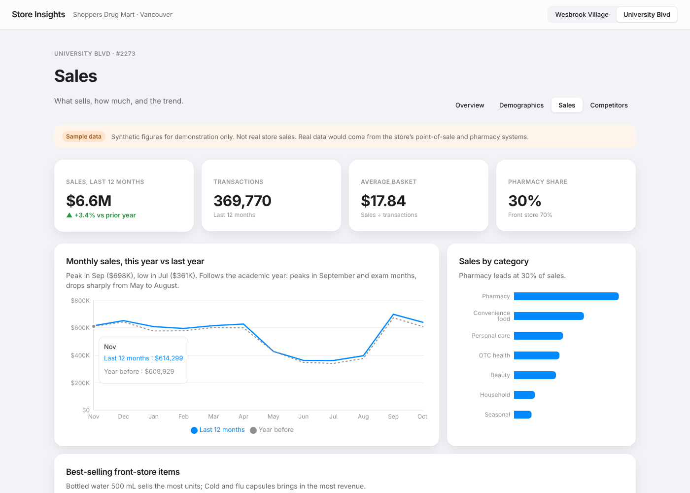
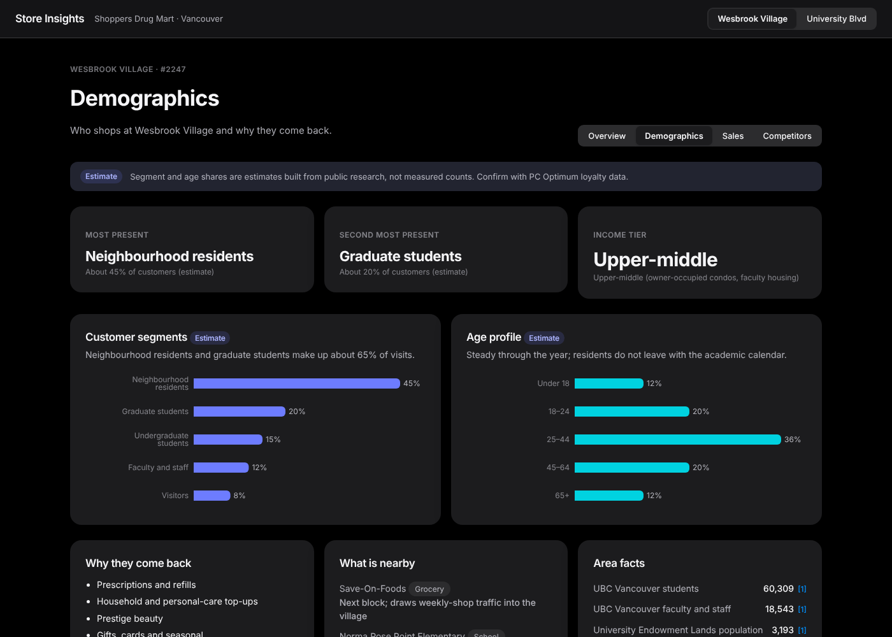
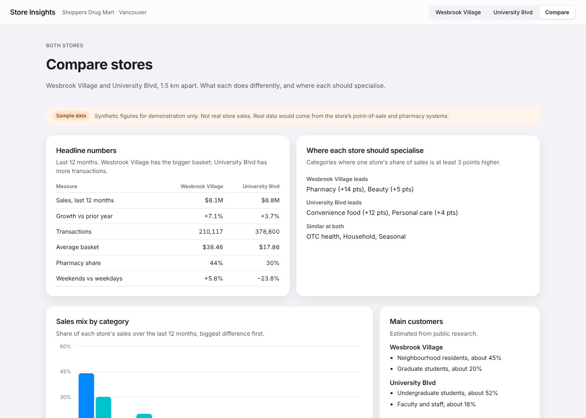

# Store Insights

**Store-level retail analytics for Shoppers Drug Mart in Metro Vancouver.** Pick a store on the map and see who lives around it, what it sells, who competes within a short walk, and what it should stock as a result.

**[Open the live dashboard](https://codingwithathul.github.io/Retail-dashboard-analytics/)** · No login, no install, works on a phone.



## Why it exists

What a store should stock depends on three local facts: who lives nearby, what the neighbours already sell, and how the store is trading. They usually sit in three places: a census site, a map and a sales report. Store Insights puts them on one page per store, and each finding ends with a call a manager can act on.

## What it covers

- **31 Shoppers Drug Mart stores in Vancouver** on one map, searchable by store number, street, postal code or neighbourhood.
- **Two full store profiles** at the University of British Columbia (#2247 Wesbrook Village and #2273 University Blvd): demographics, sales, competitors and a one-page printable brief.
- **29 City of Vancouver stores** with a light profile: a checked address, the 2021 census for the store's postal area against Metro Vancouver, and every pharmacy and supermarket within a 10-minute walk.

Scope is Metro Vancouver: Shoppers Drug Mart first, then other Loblaw banners.

## What it answers

| Question | Where it is answered |
|---|---|
| Who shops here, and how is this area different from Metro Vancouver? | **Demographics**, and the census card on every store |
| How is the store trading, and what drives the basket? | **Sales**: trend against last year, category mix, best sellers, busiest days |
| Who competes within walking distance, and for which categories? | **Competitors** and the **Nearby** panel |
| What should this store stock more of, less of, or leave to the neighbours? | **What to stock** and **Stock notes**: a compete / differentiate / avoid call per category, each tied to the figure behind it |
| How do two stores compare? | **Compare**: any two stores side by side, kept in a shareable link |
| Where do our own stores overlap? | **Network**: other Shoppers Drug Mart stores and sister Loblaw banners within a 10-minute walk of each store |
| What do I bring to a store visit? | **Store brief**: one printable Letter page per store |

Example: the Wesbrook Village store sits one block from a full-line supermarket, so the dashboard recommends ceding fresh grocery and putting that space into beauty and health services.





## Method

1. **Locate.** Store addresses come from public store pages and directories, each cross-checked against a second public source. Positions that could not be checked are marked approximate. ([notes](Research/08-vancouver-sdm-stores.md))
2. **Describe the trade area.** Statistics Canada 2021 census for each store's postal area (by census subdivision at UBC), always shown next to the Metro Vancouver figure so the difference is the finding. ([notes](Research/09-census-by-postal-area.md))
3. **Map the neighbours.** Pharmacies and supermarkets within 800 m from OpenStreetMap, each matched to a sourced profile of what that chain mainly sells. ([notes](Research/10-nearby-pharmacies-and-supermarkets.md), [what they sell](Research/11-what-nearby-stores-sell.md))
4. **Make the call.** Each category gets compete, differentiate or avoid, and each stock note states the local figure, the Metro figure, and what to do. ([notes](Research/12-stock-notes.md))
5. **Label confidence.** Every fact on screen is marked *Verified*, *Estimate* or *Sample data* and links to its source.

All research notes and sources are in [`/Research`](Research/README.md).

## Data policy

- **No internal Loblaw or Shoppers Drug Mart data is used.** Store facts and area facts are public and linked to their sources.
- **Sales figures are synthetic sample data**, generated from a fixed seed by the [data pipeline](pipeline/README.md) and labelled *Sample data* on screen. Real store exports can replace them without code changes: see [Using real store data](docs/importing-real-data.md).
- **Customer segment shares are estimates** built from public research, and labelled as such.
- **No employee names are published.** Store Leadership fields are placeholders.

## Data pipeline

```
raw CSVs ──► validate ──► transform ──► src/data/generated/sales.json ──► dashboard
public sources (StatCan census, OpenStreetMap) ──► etl census / etl nearby ──► dashboard
```

A Python and pandas pipeline in [`/pipeline`](pipeline/README.md) builds every sales number from daily, product-level data in a star schema ([data dictionary](docs/data-dictionary.md)). It validates types, keys, ranges and reconciling totals before anything reaches the dashboard, and CI fails if the published data file is out of date.

## Engineering

| Part | Choice |
|---|---|
| App | React 19, TypeScript (strict), Vite |
| Map | Leaflet with OpenStreetMap tiles, no API key |
| Charts | Recharts |
| Data | Python, pandas |
| Tests | Vitest and Testing Library (units, components), Playwright (desktop and phone), pytest (pipeline) |
| Quality gate | Lighthouse CI: every page must score 100 for accessibility or the build fails |
| Hosting | GitHub Pages, deployed by GitHub Actions on every release |

**Design** follows Apple's Human Interface Guidelines: system font and colours, a one-line takeaway above each chart, light and dark appearance from the operating system, and status shown with words and icons, never colour alone. ([notes](Research/05-apple-design-language.md))

**Delivery** is versioned: feature branches merge into `dev`, each release goes to `main` through a pull request, and every release is tagged and recorded in the [changelog](CHANGELOG.md).

## Run locally

```bash
npm install
npm run dev        # http://localhost:5173/Retail-dashboard-analytics/
npm test           # unit and component tests
npm run e2e        # browser tests, desktop and phone
npm run build      # type check and production build
npx @lhci/cli@0.15.1 autorun   # Lighthouse on every page (after a build)
```

Pipeline: see [`pipeline/README.md`](pipeline/README.md).

## Project structure

```
src/
  data/        store profiles, directory listings, census, neighbours, stock calls, generated sales
  components/  map, neighbours panel, search, badges, KPI tiles, sections
  views/       overview, demographics, sales, competitors, compare, network, store brief
  lib/         geo, pin clustering, formatting, routing
  styles/      design tokens and layout
pipeline/      Python pipeline: schema, sample generator, validation, census and nearby-place ETL
docs/          data dictionary, importing real data, screenshots
Research/      sourced research notes
e2e/           Playwright browser tests
```

## Roadmap

Planned work is tracked in GitHub Issues, starting with the [roadmap](../../issues/3): a Power BI companion model, forecasting, and wider coverage across Metro Vancouver and other Loblaw banners.

## Author

Built by [Athul Sasidharan](https://github.com/codingwithAthul), UBC Master of Data Science. [Portfolio](https://codingwithathul.github.io) · [LinkedIn](https://www.linkedin.com/in/athul-sasidharan-48a1ba195/)

## Disclaimer

Independent portfolio project. Not affiliated with or endorsed by Loblaw Companies Limited or Shoppers Drug Mart. Store names are used only to identify public locations; all trademarks belong to their owners.
